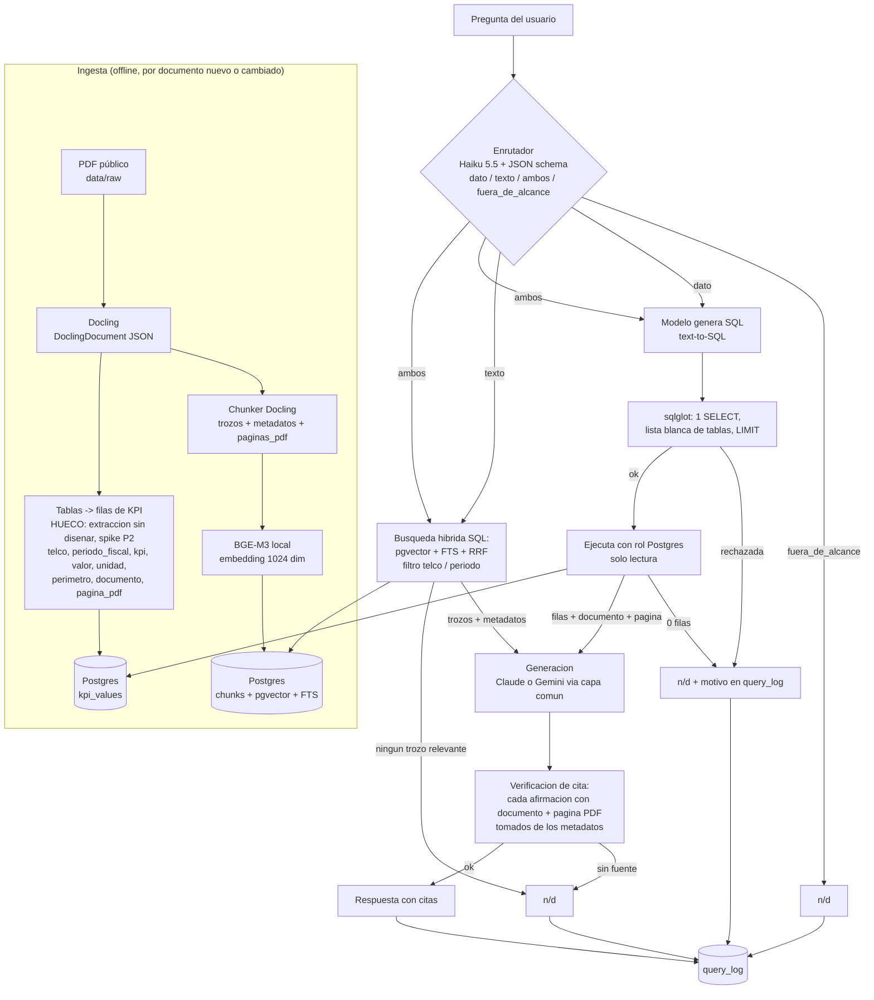

# Arquitectura y stack — analista IA de telcos

Estado: borrador T4 de P1 (1-nov-2026). Destino final: `docs/arquitectura.md`.
Fuente única de "porqués" y precios: `loop/2026-11-01-p1-arquitectura/research/stack.md` (en adelante **stack.md**). Se cita como `stack.md §N` (sección) y la fila o tabla concreta. Fecha de consulta de las fuentes: 1-nov-2026.
Etiquetas: **[DECIDIDO]** ya cerrado antes de este documento (CONTEXTO, brief o Javier) · **[HUECO]** no resuelto, declarado · **[INFERENCIA]** deducción de stack.md, no hecho de fuente externa.
Criterio de diseño: **ponytail**. Lo mínimo que resuelve: un solo Postgres, funciones planas hasta que una métrica pida más, un wrapper de modelo de una función. Cada pieza extra tiene que justificarse con una métrica que falle.

## 1. Qué es y qué no es

- Responde preguntas sobre informes públicos de Telefónica, Vodafone, Orange y Deutsche Telekom (1 anual + 4 resultados periódicos por telco; datos de P2).
- Toda respuesta cita **documento + página del PDF** (y la página impresa entre paréntesis si difiere); sin fuente, responde `n/d`.
- Solo información pública. Nunca datos corporativos de Telefónica.
- Meta de aprendizaje: la lente 3 puede decir que el corpus cabe en el contexto del modelo y que la BBDD vectorial sobra para el uso real. Se mantiene RAG **por decisión de aprendizaje** (stack.md §4.3, nota de proceso). Declarado, no escondido.

## 2. Las 10 piezas

Formato: herramienta · porqué (enlace a stack.md) · alternativa descartada.

| # | Pieza | Herramienta elegida | Porqué (fila de stack.md) | Alternativa descartada |
|---|---|---|---|---|
| 1 | **Ingesta** (PDF con tablas) | **Docling**; guardar el `DoclingDocument` en JSON, no en Markdown. **[DECIDIDO]** | stack.md §1, fila Docling: MIT, tablas con TableFormer, nº de página por elemento; Markdown pierde páginas (discussions/1012). Contraste de cifras clave con pdfplumber en P2 (§1, recomendación). | PyMuPDF: AGPL o licencia comercial (§1, fila PyMuPDF). Camelot: necesita Ghostscript y en modo stream (sin bordes) puede bajar a ~50-70 % de acierto (§1, fila Camelot). Tabula: requiere Java; es rápida solo en plantillas fijas y §1 no da dato de acierto bajo (§1, fila Tabula). pdfplumber como lector único: tablas sin bordes solo parcial (§1, fila pdfplumber); queda como contraste. |
| 2 | **Troceado** | **Chunker de Docling** (respeta secciones y tablas). Metadatos por trozo: `telco, periodo_fiscal, documento, tipo_doc, paginas_pdf[], seccion`. Cada tabla = un trozo propio en Markdown **y** sus filas a `kpi_values` (ruta DATOS). | stack.md §4.1: página por item en `chunk.meta.doc_items[].prov[].page_no`; metadatos propuestos en la misma sección [INFERENCIA]. | Troceado por tamaño fijo (splitters de LangChain): rompe tablas y secciones (§4.1; [INFERENCIA] sin fuente externa, se descarta por ese motivo y no se ha medido). |
| 3 | **Embeddings** (local, sin API) | **BGE-M3** (1.024 dim, 8.192 tokens, MIT). **[DECIDIDO]** Reto en P3: Qwen3-Embedding-0.6B contra el golden set. Fijar la revisión del modelo. | stack.md §4.2, tabla de embeddings: MIT, 1.024 dim (cabe en el índice de pgvector, límite 2.000 para `vector`, §4.3 fila Escala), contexto largo. | multilingual-e5-large: corta la entrada a 512 tokens (§4.2). Jina v3/v5: CC BY-NC, licencia no comercial (§4.2). Qwen3-0.6B: no descartado, es el reto de P3. |
| 4 | **BBDD vectorial** | **Postgres + pgvector** (0.8.7). Una sola BBDD para vectores, tablas de KPIs y `query_log`. **[DECIDIDO]** | stack.md §4.3, filas "Filtro por metadatos" (filtros = `WHERE` SQL), "Persistencia" (transaccional, mismo backup) y "Valor en producción". | **Chroma**: no es seguro con varios escritores sobre la misma ruta local (§4.3 fila Persistencia; cookbook system_constraints). Plan B solo para un prototipo de 1 día. **DuckDB** como almacén: un solo proceso escritor (§2 tabla de almacén). |
| 5 | **Recuperación** | **Híbrida dentro de Postgres**: denso (pgvector) + FTS nativo + fusión **RRF** en SQL, con filtro por `telco`/`periodo_fiscal`. **[DECIDIDO]** Reranker y BM25 solo si recall@k lo pide. | stack.md §4.4: recomendación "denso + FTS + RRF; añadir pg_textsearch o reranker solo si recall@k del golden set lo pide"; §4.3 fila "Híbrida". Siglas como OIBDA favorecen el componente léxico [INFERENCIA, §4.4]. | Motor aparte para búsqueda léxica: **[DECIDIDO]** no. pg_textsearch (BM25): licencia y Docker sin confirmar (§4.4, [HUECO]); candidata si falla recall@k. bge-reranker-v2-m3: tamaño y velocidad en CPU sin dato (§4.4, [HUECO]); candidato si falla recall@k. |
| 6 | **LLM** | **Claude API** principal (key de Javier); **Gemini Flash** segundo modelo (P4). Capa común propia (sec. 5). Enrutado por tarea: Haiku 5.5 para enrutador y extracción; Sonnet 5.5 u Opus 5.5 para SQL y respuesta. **Se decide midiendo en el golden set.** | stack.md §5.1 (wrapper propio), §5.2 (Gemini: nivel gratuito, `gemini-3.8-flash` y `gemini-3.1-flash-lite`), §5.3 (Anthropic recomienda el modelo más barato que cumple, medido por coste por tarea completada). | LiteLLM: la página no declara licencia ni lista Gemini, y traducir a formato OpenAI puede ocultar caché y structured outputs de Anthropic (§5.1). OpenAI (`gpt-5.4-mini`) como 2.º modelo: de pago, reservado si Gemini da 429 o chocan sus condiciones UE (§5.2). Función Citations de Claude: **[DECIDIDO]** no, incompatible con structured outputs (§5.1). |
| 7 | **Agente** | P3: **funciones Python planas**. P4: **LangGraph** (MIT) con un nodo enrutador y aristas condicionales. | stack.md §6.1 (recomendación: planas en P3, LangGraph en P4, fijado en CONTEXTO A8-L2) y §3 (LangGraph como contenedor del enrutador). | Seguir con funciones planas en P4: válido para producción, pero no cubre el hueco "LangGraph" del CV (CONTEXTO, Origen). [HUECO] la API de aristas condicionales de LangGraph no está verificada en doc oficial (§3 y Huecos): comprobar en P4. |
| 8 | **Evals** | **Harness propio con pytest** (recall@k, MRR, exactitud de resultado SQL, accuracy del enrutador, tasa de abstención correcta) + **DeepEval** solo para fidelidad. Registro: tabla propia `query_log` desde P3; **Langfuse** (autoalojado) en P5. **[DECIDIDO]** Langfuse en P5. | stack.md §6.2 (recomendación y "métrica por pieza"), §6.3 (tabla propia + Langfuse MIT autoalojable). | **Ragas**: repo sin commits desde feb-2026 y dio 0,777 a una respuesta incorrecta (§6.2 fila Ragas). **promptfoo**: dio 0,800 a una respuesta incorrecta; instalación por npm (§6.2). **LangSmith**: autoalojado solo en Enterprise (§6.3). |
| 9 | **API** | **FastAPI**, un proceso uvicorn por contenedor. | stack.md §7, primera viñeta: en contenedores, un proceso por contenedor y escalar con más contenedores. | **Flask**: su async corre sobre WSGI con un worker por petición, y su doc de inicio no documenta validación de esquema ni OpenAPI (stack.md §10, fila Flask; la ausencia es de la doc consultada, no prueba de que no exista [INFERENCIA]). **Litestar**: alternativa válida sin ventaja clara aquí (§10, recomendación). FastAPI cubre async + validación Pydantic + OpenAPI automática sin piezas extra (§10, fila FastAPI). Django REST: n/d, no consultado (§10). |
| 10 | **Despliegue** | **Docker Compose**: servicios `postgres` (con pgvector) y `api`. P5 añade Langfuse. Kubernetes aparcado como ampliación opcional al final de P6. | stack.md §7, viñeta "Composición mínima" [INFERENCIA]; licencia de Docker Desktop para uso personal (§7, segunda viñeta). | DuckDB embebido + un contenedor: descartado por concurrencia (§2, §7 "Alternativa"). Kubernetes: **[DECIDIDO]** aparcado. |

Calidad de código (transversal, no es pieza del sistema): pytest + mutmut + bandit + pip-audit + gitleaks en CI Linux; semgrep como complemento. **mutmut solo en WSL o CI** (no corre en Windows nativo). Fuente: stack.md §8, recomendación y fila mutmut.

**Dependencia pendiente (confirmada en parte):** Docker **24.0.2** está instalado en el PC de Javier (dato del usuario, 2-nov-2026). Falta comprobar que el motor arranca (`docker info`) antes de P3. Postgres corre como imagen `pgvector` dentro de Docker, sin instalación aparte.

## 3. Dos rutas con enrutador delante (lente 1)



### 3.1 Enrutador: cómo decide dato vs texto

- Un nodo (función en P3, nodo de LangGraph con arista condicional en P4) que llama a **Haiku 5.5 con salida estructurada** y esquema `{ruta: dato|texto|ambos|fuera_de_alcance, confianza: número, telco: string|null, periodo_fiscal: string|null}`. `telco` y `periodo_fiscal` (null si la pregunta no los da) son la fuente de los filtros de la ruta TEXTO (3.3) y de los casos límite (3.4); el nodo X1 del Mermaid los recibe de aquí [INFERENCIA, diseño propio]. Fuente de la clasificación: stack.md §3, fila "Clasificador con Haiku 5.5".
- Criterio escrito en el prompt del clasificador:
  - **dato**: pide un número o KPI concreto (valor, variación, ranking) de una telco y un periodo. Ej.: "¿Cuántos accesos tenía Orange a cierre de 2025?".
  - **texto**: pide una definición, norma, procedimiento, política o explicación de una nota. Ej.: "¿Cómo define Vodafone el free cash flow?".
  - **ambos**: mezcla las dos. Ej.: "¿Cómo define Orange OIBDA y cuánto fue en 2025?" (el caso que rompe las reglas, stack.md §3 fila Reglas). Ejecuta las dos rutas y fusiona en la generación.
  - **fuera_de_alcance**: no es sobre las 4 telcos ni sobre el corpus. Responde `n/d` sin gastar más llamadas.
- La `confianza` se valida **en código**: el esquema no admite `minimum/maximum` y el modelo puede cambiar mayúsculas del enum (stack.md §3, fila clasificador, columna Contras). Comparar sin distinguir mayúsculas. Umbral de confianza bajo → tratar como `ambos` (coste de más, nunca respuesta de menos). Valor del umbral: **[HUECO]**, se calibra en P3 con el golden set.
- Reglas regex: solo como pre-filtro opcional si `query_log` demuestra tráfico trivial (stack.md §3, Recomendación).
- Se mide con la etiqueta dato/texto del golden set (accuracy de ruta, stack.md §6.2 "Métrica por pieza").

### 3.2 Ruta DATOS

1. **Almacén:** tabla larga `kpi_values(telco, periodo_fiscal, kpi, valor, unidad, perimetro, documento, pagina_pdf, origen, version, vigente)`, en el mismo Postgres. Cada fila lleva documento y página: es el contrato de cita. Fuente: stack.md §2, recomendación Postgres. `version` y `vigente` copian los de `documentos`; la consulta generada filtra siempre `vigente = true` [INFERENCIA, diseño propio].
   - **Tabla `documentos`** [INFERENCIA, diseño propio]: `(documento PK, telco, tipo_doc, periodo_fiscal, url, hash_sha256, version, vigente)`. Una fila por PDF. Es la fuente del reindexado (sec. 6, lente 7: si cambia el hash se reingesta) y de la retirada de obsoletos (`vigente = false` en la versión anterior de la misma `telco`+`periodo_fiscal`).
2. **Carga:** las tablas que Docling detecta (pieza 1) se convierten en filas. **[HUECO, riesgo prioritario]** El **cómo** (celda de tabla PDF → fila: rótulo → KPI canónico, perímetro, unidad, `periodo_fiscal`) **no está diseñado**; ver sec. 9, punto 10. Contraste de cifras clave con pdfplumber en P2 (stack.md §1). Las celdas que no se pueden leer con certeza no se cargan; no se rellenan.
3. **Consulta:** el modelo recibe el esquema de `kpi_values` (y el glosario de equivalencias de KPIs) y genera un SQL.
4. **Validación con sqlglot**, siete reglas de stack.md §2 ("Validación de la consulta generada"): parsear con el dialecto del motor; solo un SELECT; recorrer el árbol rechazando nodos de escritura; lista blanca de tablas; tope de filas que el modelo no pueda subir; rol de solo lectura; sqlglot con versión fijada y tests de consultas maliciosas.
5. **Ejecución** con un rol de Postgres que solo tiene `SELECT` sobre `kpi_values`. El validador reduce el riesgo; el rol es la barrera real (stack.md §2, regla 5).
6. **Respuesta:** 0 filas → `n/d` (stack.md §2, última viñeta, marcada [INFERENCIA] allí). Con filas, el valor y la cita salen de las columnas `documento` y `pagina_pdf`, no del texto que escriba el modelo.
7. **Métrica:** exactitud de resultado (se comparan resultados, no el texto SQL, con decimales redondeados). Fuente: stack.md §2 regla 7 y §6.2.

### 3.3 Ruta TEXTO

1. Embedding de la pregunta (BGE-M3) + FTS, filtrados por `telco`/`periodo_fiscal` cuando el enrutador los extrae.
2. Fusión RRF en SQL; k a calibrar (**[HUECO]**: valor de k, se fija midiendo recall@k en P3).
3. Los k trozos entran en el contexto **con sus metadatos**; el modelo responde solo con lo que respaldan.
4. Si ningún trozo supera el umbral de relevancia → `n/d`. Umbral: **[HUECO]**, se calibra con las preguntas sin respuesta del golden set.
5. Métrica: recall@k y MRR de "documento + página correctos" (stack.md §6.2, harness propio); fidelidad con DeepEval.

### 3.4 Casos límite (diseño propio, ponytail) [INFERENCIA]

Ninguno tiene fila en stack.md; son decisiones de este documento, a validar con el golden set.

- **Nivel de `n/d`:** es **por afirmación**. Una afirmación sin `fuente_id` válido se descarta o se marca `n/d`; la respuesta global es `n/d` solo si ninguna afirmación conserva fuente.
- **Ruta "ambos" con una rama vacía:** se responde con la rama que sí tiene resultado y la otra se declara `n/d` parcial en la propia respuesta (p. ej. definición con cita + "valor: n/d"). Si las dos están vacías, la respuesta global es `n/d`.
- **SQL inválido, rechazado o que falla al ejecutar:** un reintento pidiendo al modelo corregir el SQL con el mensaje de error; si falla otra vez, `n/d` con el motivo en `query_log`. En "ambos", la rama texto sigue.
- **Error de la API del LLM (timeout, 429, 5xx):** un reintento con espera; si persiste, `n/d` con el motivo en `query_log`. No se cambia de proveedor en silencio (cambiarlo es configuración, sec. 5).
- **JSON de salida inválido (enrutador o generación):** un reintento; si persiste, enrutador → tratar como `ambos` (misma regla que confianza baja); generación → `n/d` con motivo en `query_log`.
- **Pregunta sin telco o sin periodo identificable:** no se inventa. En ruta DATOS, si falta telco o periodo, `n/d` indicando qué falta (no se pide aclaración: P3 no tiene conversación). En ruta TEXTO, se busca sin filtro de ese campo y manda el umbral de relevancia.

## 4. Orden de construcción (CONTEXTO)

Golden set (T6, P1) → versión mínima (P3: ingesta, ambas rutas con funciones planas, `query_log`) → medir → mejorar **solo la pieza que falla** (reranker, BM25, cambio de embeddings, cambio de modelo) → repetir. Ante un fallo, primero se decide si es de recuperación o de generación mirando `query_log`; no se toca el prompt sin saberlo (lente 6).

## 5. Capa común de modelo (Claude / Gemini)

Decisión: wrapper propio mínimo, sin LiteLLM (stack.md §5.1). Es una función y un `Protocol`:

```python
class Completion(NamedTuple):
    text: str
    parsed: dict | None      # si se pidió esquema
    tokens_in: int
    tokens_out: int
    model: str

class LLM(Protocol):
    def complete(self, system: str, messages: list[dict],
                 schema: dict | None = None) -> Completion: ...
```

- **Un solo método.** Con `schema`, devuelve JSON validado (structured outputs de Claude; en Gemini, su equivalente: **[HUECO]**, stack.md no verifica la API de salida estructurada de Gemini; se comprueba en P4).
- **Dos adaptadores** (`llm/claude.py`, `llm/gemini.py`), cada uno envuelve su SDK. No hay clase base ni fábrica.
- **Cambio de proveedor:** por configuración. Un `config.toml` mapea tarea → modelo, por ejemplo `router = "claude-haiku-5-5"`, `sql = "claude-sonnet-5-5"`, `answer = "claude-sonnet-5-5"`, y en la comparativa de P4 `answer = "gemini-3.8-flash"`. Los IDs de Claude son los de stack.md §9 (tabla Claude, columna "ID API"). Los IDs de Gemini salen de stack.md §9 (tabla Gemini). Cambiar de proveedor = cambiar esa línea; el resto del código solo conoce `LLM`.
- **Registro de coste:** cada `Completion` lleva tokens; `query_log` calcula coste con una tabla de precios en `config.toml` (precios de sec. 8).
- **Caché de prompt de Anthropic** (stack.md §7 "Caché", a): se activa en el adaptador de Claude para el prefijo estable (esquema + glosario), si supera el mínimo de 512 tokens. Detalle interno del adaptador; el `Protocol` no cambia.
- **Datos hacia fuera:** al modelo viajan la pregunta y trozos de documentos públicos. Con Gemini en nivel gratuito Google puede usar prompts y respuestas para mejorar productos (stack.md §5.2, fila "Condiciones de datos"). Regla: nada de datos de Telefónica, en ningún proveedor.

### 5.1 Contrato de cita

- **Citas desde los metadatos del fragmento, no desde la función Citations de Claude [DECIDIDO]**: Citations es incompatible con structured outputs (error 400) y esta vía funciona igual en Claude y Gemini (stack.md §5.1, última viñeta).
- Cada trozo y cada fila de `kpi_values` lleva `documento` y `pagina_pdf` (índice de página del PDF, 1-based; stack.md §1 último punto, a verificar en P3 con un PDF real [INFERENCIA]). Si la página impresa difiere, se guarda también `pagina_impresa` y se muestra entre paréntesis — convención **aprobada** por Javier (2-nov-2026).
- Formato de salida de la generación (esquema JSON):

```json
{
  "respuesta": "texto",
  "afirmaciones": [
    {"texto": "...", "fuente_id": "chunk:123"}
  ]
}
```

- **La aplicación, no el modelo, escribe la cita.** El modelo solo devuelve `fuente_id`; el código sustituye cada `fuente_id` por `documento, p. PDF N (impresa M)` leyendo los metadatos. Un `fuente_id` que no esté entre los trozos o filas entregados se rechaza.
- **Sin fuente → `n/d`:** una afirmación sin `fuente_id` válido se marca `n/d` y se omite (nivel por afirmación, sec. 3.4); la respuesta global es `n/d` solo si ninguna afirmación queda respaldada, hay 0 filas SQL, el contexto no tiene trozos relevantes o la ruta es `fuera_de_alcance` (regla de CONTEXTO).
- Comprobación en evals: la cita devuelta coincide con documento y página del golden set (parte de recall@k y de fidelidad).

## 6. Lentes de producción RAG 1-7

| Lente | Respuesta concreta en esta arquitectura | Hueco declarado |
|---|---|---|
| **1. Tipo de pregunta** (dato vs texto) | Dos rutas con enrutador delante (sec. 3): DATOS por SQL generado a `kpi_values`; TEXTO por RAG sobre pgvector. Ambos → las dos y fusión. Fuente: stack.md §2, §3. | **Hueco:** la distribución real dato/texto de las preguntas no se conoce hasta tener el golden set (T6) y, después, `query_log`. Umbral de confianza del enrutador sin calibrar. |
| **2. Corpus** | 4 telcos × (1 anual + 4 resultados periódicos) = 20 PDFs públicos (brief; T2 los localiza). Formatos: PDF con tablas, texto nativo; escaneados no esperados, Docling hace OCR si aparecen (stack.md §1). Cambian por publicación (trimestral/semestral/anual); versión vigente = la más reciente por `telco`+`periodo_fiscal`. **Permisos:** todos públicos, usuario único; sin permisos por documento. **Salidas a API externa:** embeddings en local, nada sale; pregunta y trozos públicos sí viajan a Claude/Gemini (sec. 5). | **Hueco:** volumen en páginas (lo mide T2; stack.md §1 solo da la tasa de Docling: 3,1 s/página de media en un CPU x86 del paper de 2025, es decir, ~52 min por 1.000 páginas [INFERENCIA]). **Hueco:** permisos por documento no se diseñan porque no hay corpus no público; en un caso Telefónica real harían falta (filtro por ACL en `WHERE`, posible con pgvector, stack.md §4.3 fila Filtro) y no se ha diseñado. |
| **3. Alternativa existente** | Si el corpus entero cabe en 1M tokens (los modelos 5.x lo permiten, stack.md §9 nota bajo la tabla Claude), la BBDD vectorial sería innecesaria para el uso real. Se mantiene por **decisión de aprendizaje** (stack.md §4.3, nota de proceso). | **Hueco:** nº de páginas/tokens del corpus, de T2. **Hueco:** no se ha investigado si hay herramienta ya aprobada en Telefónica que cubra el 80 % (no se puede consultar sin datos corporativos; es pregunta para Javier). |
| **4. Set de evaluación** | T6: 30-50 preguntas con respuesta, documento y página, etiquetadas dato/texto, con preguntas sin respuesta en el corpus (deben dar `n/d`). Se construye **antes** que el código (sec. 4). | **Hueco:** no hay usuarios reales; las preguntas son las que haría un controller financiero (Javier), según brief. |
| **5. Piezas y métrica** | Troceado: ¿el trozo conserva tabla y página? Recuperación: recall@k y MRR. Generación: fidelidad (DeepEval) + cita correcta. Enrutador: accuracy de ruta. SQL: exactitud de resultado. Mejoras en este orden, solo si la métrica falla: reranker, BM25, reescritura de consulta. Fuente: stack.md §6.2 ("Métrica por pieza") y §4.4. | **Hueco:** valores objetivo de cada métrica sin fijar hasta la primera medición en P3. Reescritura de consulta: no investigada en stack.md. |
| **6. Registro por consulta** | Tabla `query_log` en Postgres desde P3: pregunta, ruta, trozos y puntuaciones, contexto enviado, SQL generado, respuesta, citas, tokens, coste, latencia, versión del corpus (stack.md §6.3 fila "Tabla propia"). Langfuse en P5 para trazas y datasets. | **Hueco:** consumo de RAM de Langfuse en un PC doméstico sin verificar (stack.md §6.3). |
| **7. Escala, coste y operación** | Perfilado: latencia y coste por pieza en `query_log` antes de optimizar. Caché: prompt caching de Anthropic, Batch API (−50 %) para pasadas del golden set, y caché exacta de respuestas en Postgres con clave (pregunta normalizada, versión del corpus), invalidada al reindexar (stack.md §7 "Caché" a, b, c). Modelo barato para lo simple: Haiku 5.5 (stack.md §5.3). Reindexado incremental: hash del PDF en `documentos`; si cambia, se borran sus trozos y filas `kpi_values` y se reingesta. Un `periodo_fiscal` nuevo no toca los demás. Retirada de obsoletos: columna `vigente` por documento. Dueño: Javier. | **Hueco:** caché semántica no investigada (stack.md §7, [HUECO]). **Hueco:** runbook y alerta no diseñados; entran en P6. **Hueco:** el reindexado incremental es diseño mío [INFERENCIA], sin fuente en stack.md. |

Veredicto de las lentes: con estos huecos, el sistema saldría como **prueba de concepto** porque faltan permisos por documento, runbook y alertas, y la medición de volumen y del set de evaluación. Es lo esperable en P1; el objetivo es declararlo (CONTEXTO: "esto saldría como prueba de concepto porque falta X").

## 7. Estructura de carpetas del repo

```
analista-ia-telcos/
├─ README.md                 empieza aquí
├─ CONTEXTO.md               objetivo, reglas, check
├─ memory/                   feedback.md, project.md... (nace cuando hay algo que guardar)
├─ docs/                     documentos finales, versionados
│  ├─ arquitectura.md        este documento
│  ├─ glosario-kpis.md       DECIDIDO: ubicación final del glosario (T5)
│  ├─ golden-set.md          versión legible del golden set (T6)
│  ├─ plan-fases.md          plan P2-P6 (T8)
│  ├─ calidad-codigo.md      ponytail + examen (T7)
│  └─ fuentes-pdf.md         tabla de los 20 PDFs (T2)
├─ eval/
│  ├─ golden_set.jsonl       DECIDIDO: ubicación final del golden set (formato máquina, reutilizado en P3-P5)
│  └─ test_*.py              harness pytest: recall@k, MRR, exactitud SQL, ruta, abstención
├─ data/                     DECIDIDO: ubicación final de los datos de P2
│  ├─ fuentes.csv            en git: telco, tipo, periodo_fiscal, fecha, URL, nº páginas, hash SHA-256
│  ├─ raw/<telco>/*.pdf      fuera de git (.gitignore): se re-descargan desde fuentes.csv
│  └─ parsed/<telco>/*.json  fuera de git: DoclingDocument, regenerable
├─ src/analista/
│  ├─ ingest.py              Docling -> trozos + filas de KPI -> Postgres
│  ├─ route.py               enrutador (clasificador Haiku + validación de confianza)
│  ├─ sql.py                 text-to-SQL + validación sqlglot + ejecución con rol de solo lectura
│  ├─ retrieve.py            híbrida pgvector + FTS + RRF
│  ├─ answer.py              generación + contrato de cita + n/d
│  ├─ llm/                   claude.py, gemini.py, __init__.py (Protocol LLM)
│  ├─ graph.py               LangGraph (nace en P4)
│  └─ api.py                 FastAPI (nace en P6)
├─ db/init.sql               tablas, índices, rol de solo lectura
├─ config.toml               tarea -> modelo, precios, umbrales
├─ tests/                    tests unitarios (sqlglot con consultas maliciosas, citas, n/d)
├─ examenes/                 exámenes de revisión de código de cada fase (T7)
├─ docker-compose.yml        postgres (pgvector) + api
├─ .github/workflows/ci.yml  pytest, bandit, pip-audit, gitleaks, mutmut (Linux)
└─ loop/                     borradores de cada encargo (scratchpad del OO, no se edita a mano)
```

Decisiones de ubicación:
- **Glosario** → `docs/glosario-kpis.md`. Es documentación y además el prompt de la ruta DATOS lo cita; cuando haga falta en código, `sql.py` lo lee de ahí.
- **Golden set** → `eval/golden_set.jsonl` (fuente de verdad, máquina) y `docs/golden-set.md` (vista legible generada del jsonl). Se versiona en git porque es el contrato de calidad.
- **Datos de P2** → `data/`. PDFs fuera de git (son públicos, pero grandes y re-descargables); en git quedan `fuentes.csv` con URL y hash para reproducir. [INFERENCIA] sin fuente en stack.md; es decisión de proyecto. Reproducibilidad: un PDF re-descargado solo cuenta como el mismo documento si su hash SHA-256 coincide con el de `fuentes.csv`.
- Cada carpeta nace cuando tiene contenido (CONTEXTO, arranque mínimo): `graph.py`, `api.py` y `docker-compose.yml` no existen hasta P4/P6/P3.
- Integración: T4 fija estas rutas; el orquestador mueve los drafts de T5/T6 a ellas al integrar.

## 8. Coste de API por fase

Precios de stack.md §9 ($/MTok entrada / salida, estándar). Estimación **de orden de magnitud**; el tamaño del prompt es una **suposición mía**, no un dato: 1 pasada del golden set = 50 preguntas × 5.000 tokens de entrada × 500 de salida = 0,25 MTok entrada y 0,025 MTok salida. (Es el mismo supuesto que usa stack.md §5.2 para OpenAI.)

| Modelo (stack.md §9) | $/MTok in / out | Coste de 1 pasada (cálculo) |
|---|---|---|
| Claude Haiku 5.5 (≤100k) | 0,10 / 0,50 | 0,25×0,10 + 0,025×0,50 = **0,04 $** (0,0375) |
| Claude Sonnet 5.5 | 2 / 10 | 0,25×2 + 0,025×10 = **0,75 $** |
| Claude Opus 5.5 | 4 / 20 | 0,25×4 + 0,025×20 = **1,50 $** |
| Claude Fable 5.1 | 10 / 50 | 0,25×10 + 0,025×50 = **3,75 $** |
| Gemini 3.8-flash | 0,75 / 3,75 | 0,25×0,75 + 0,025×3,75 = **0,28 $** (0 en nivel gratuito) |
| Gemini 3.1-flash-lite | 0,25 / 1,50 | 0,25×0,25 + 0,025×1,50 = **0,10 $** (0 en nivel gratuito) |

| Fase | Uso de API | Estimación |
|---|---|---|
| **P1** | Ninguno (documentos y búsqueda web; brief). | **0 $** |
| **P2** | Ninguno: descarga de PDFs y contraste con pdfplumber, todo local. | **0 $** |
| **P3** | ~10 pasadas del golden set con Sonnet 5.5 (rango hasta Opus 5.5); el enrutador (Haiku, llamadas cortas) es despreciable a este nivel. La ingesta no usa API (Docling y BGE-M3 locales). | **7,5 $** con Sonnet · **15 $** con Opus |
| **P4** | Comparativa Claude vs Gemini: 5 pasadas Claude (3,75 $ con Sonnet; 7,5 $ con Opus) + 3 pasadas Gemini 3.8-flash (0,84 $, o 0 $ en nivel gratuito). | **4,6 $** (Sonnet) · **8,3 $** (Opus) |
| **P5** | Juez de fidelidad de DeepEval con Haiku 5.5: 5 pasadas × 3 llamadas de juez por pregunta ≈ 15 pasadas Haiku. | **0,6 $** |
| **P6** | Una pasada de humo del sistema desplegado con Sonnet 5.5 (Opus 1,5 $). | **0,75 $** (Sonnet) · **1,5 $** (Opus) |
| **Total** | | **≈ 13 $** (Sonnet) a **≈ 25 $** (Opus) |

(Suma Sonnet: 7,5 + 4,59 + 0,56 + 0,75 = 13,4. Suma Opus: 15 + 8,34 + 0,56 + 1,5 = 25,4.)

Matices, todos de stack.md:
- Los tokenizadores de Claude 4.7+ generan ~30 % más tokens para el mismo texto (stack.md §7, última viñeta). Los números de Claude pueden subir ~30 %; el total quedaría en torno a 17-33 $. Es margen, no cálculo.
- Batch API −50 % (stack.md §7 caché b) para las pasadas del golden set, y lectura de caché de prompt al 0,1× o 0,05× de la entrada (stack.md §7 caché a). No se han descontado: la estimación es de techo.
- Haiku 5.5 cobra la tarifa alta (0,50/2,50) si el prompt supera 100k tokens (stack.md §9). Los prompts de esta estimación (5.000 tokens) quedan muy por debajo.
- **Gemini 3.8-flash duplica precio el 1-ene-2027** (0,75→1,50 in; 3,75→7,50 out; stack.md §5.2 y §9). Afecta a P4 solo si cae después de esa fecha y se paga; con `gemini-3.1-flash-lite` o nivel gratuito, no.
- Los precios deben **re-verificarse en P3** (plan.md, riesgo 4). **El tope de gasto mensual se decide al llegar a P3** (brief), no antes; este cuadro es la entrada para decidirlo.
- **[HUECO]** El tamaño real de prompt depende de k y del tamaño de los trozos; hasta medirlo en P3, el rango anterior es una suposición. No incluye coste de infraestructura (Postgres y Docker locales; Docker Desktop gratis para uso personal, stack.md §7).

## 9. Huecos y dependencias abiertas (resumen)

1. **Docker en el PC de Javier: instalado (24.0.2).** Falta un `docker info` para confirmar que el motor arranca antes de P3; Postgres va como imagen pgvector.
2. Volumen del corpus en páginas (T2) → decide lente 3 y tiempo de ingesta.
3. Umbrales sin calibrar: confianza del enrutador, relevancia mínima de la ruta TEXTO, k de recuperación (P3).
4. Salida estructurada de Gemini y aristas condicionales de LangGraph: API no verificada en doc oficial (comprobar en P4).
5. Español en BGE-M3: el listado abierto no lo confirma (stack.md §4.2 y Huecos). Verificar en la ficha del modelo antes de P3; si no está, el reto Qwen3-0.6B sube de prioridad.
6. Imagen Docker oficial de pgvector sin confirmar (stack.md §4.3 fila Docker). Se decide al montar P3.
7. Permisos por documento, runbook, alertas, caché semántica: no diseñados (lente 2 y 7).
8. ~~Framework HTTP sin comparativa~~ **Resuelto (2-nov-2026):** stack.md §10 compara FastAPI, Flask y Litestar. Quedan huecos menores allí (Django REST n/d; compatibilidad de versión de Pydantic).
9. ~~Convención de página pendiente de ok~~ **Resuelto (2-nov-2026):** se cita la página del archivo PDF y, si no coincide con la impresa, esta entre paréntesis.

10. **[HUECO, riesgo prioritario del proyecto] Extracción de KPIs (celda de tabla PDF → fila de `kpi_values`) sin diseñar.** Es la base de la ruta DATOS: si falla, falla toda la ruta. Tres enfoques candidatos, **sin elegir**: (a) plantilla determinista por telco/documento; (b) modelo barato (Haiku) que mapea rótulo → KPI canónico; (c) carga manual. Decisión diferida a un **spike al inicio de P2 con 3 PDF reales**; criterio: fiabilidad vs coste vs esfuerzo, medido en esos 3 PDF. [INFERENCIA / decisión de proceso, no respaldado por stack.md.]
11. **[HUECO] FTS multilingüe.** El FTS nativo de Postgres + RRF usa stemming por idioma y el corpus es multilingüe (ES/DE/EN/FR), lo que degrada el componente léxico (ya señalado en stack.md §4.4). Opciones sin elegir: configuración FTS por idioma del documento, o apoyarse más en el denso. Se decide midiendo recall@k en P3.
12. **[HUECO] Rechazo del enrutador sin medir.** `fuera_de_alcance → n/d` no tiene salvaguarda: un rechazo erróneo es "respuesta de menos", contra el principio "coste de más, nunca respuesta de menos" (3.1). No está medido; se vigilará con las preguntas del golden set (accuracy de ruta, en particular falsos `fuera_de_alcance`).

## Cambios ciclo 1

- Pieza 9 (API): alternativa descartada Flask (+ Litestar sin ventaja clara, Django REST n/d), cita stack.md §10; hueco 8 de la sec. 9 marcado resuelto.
- Casos límite: arista `X1 -> n/d` en el Mermaid; nueva sec. 3.4 (nivel de `n/d` por afirmación, "ambos" con rama vacía, SQL fallido, error de API, JSON inválido, sin telco/periodo), todo [INFERENCIA]; `kpi_values` con `version` y `vigente`; tabla `documentos` definida en 3.2.
- Pieza 1: Ghostscript y acierto 50-70 % solo a Camelot; Tabula = Java, rápida en plantillas fijas.
- Sec. 3.2 punto 6: añadido que la viñeta de stack.md §2 es [INFERENCIA].
- Sec. 7: frase de reproducibilidad reescrita.

## Cambios ciclo 3
- Sec. 5.1 "Sin fuente": alineada con 3.4 (n/d por afirmacion; global solo si ninguna queda respaldada).
- `periodo` -> `periodo_fiscal` en nombres de campo/columna (8 ocurrencias). Se dejo `periodo` en prosa y en la etiqueta del Mermaid (l.57, no tocar).

## Cambios ciclo 4
- S1: extracción de KPIs declarada como hueco/riesgo prioritario en 3.2 pto 2, nodo T del Mermaid y sec. 9 punto 10 (3 enfoques sin elegir, spike P2 con 3 PDF).
- S2-2: esquema del enrutador (3.1) ampliado con `telco` y `periodo_fiscal` (nullable).
- S2-1 y S2-3: sec. 9 puntos 11 y 12 (declarados, sin resolver). S3 sin tocar.
